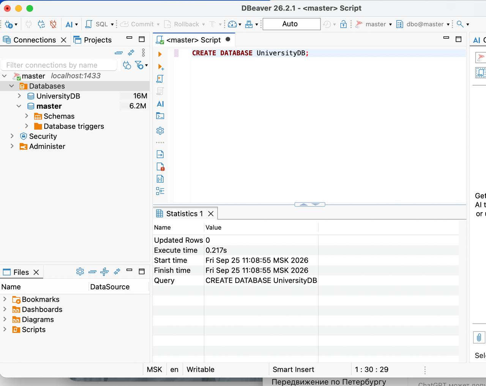
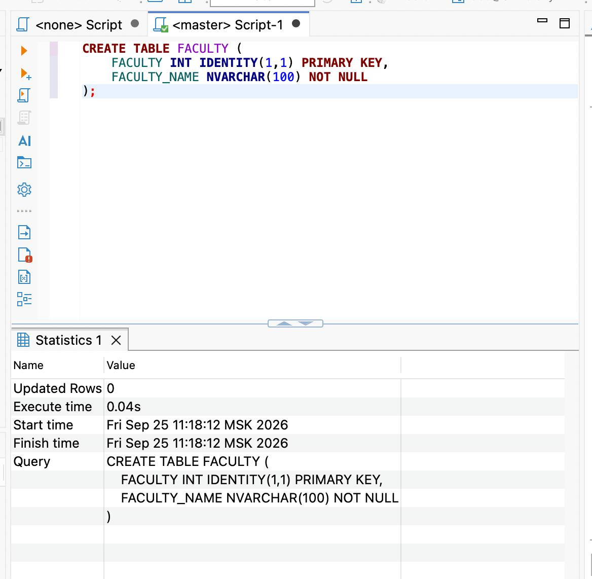

##Задание: Вам нужно создать собственную базу данных с 5 и более таблиц, каждая из которых связана с другой, кроме 1

Достаньте от туда 1 строчку из каждой таблицы с помощью T-SQL

загрузите бд на репозиторий вместе с фото диаграммой бд и скрином где показон вывод строк

Создание БД:

Создание первой таблицы:

