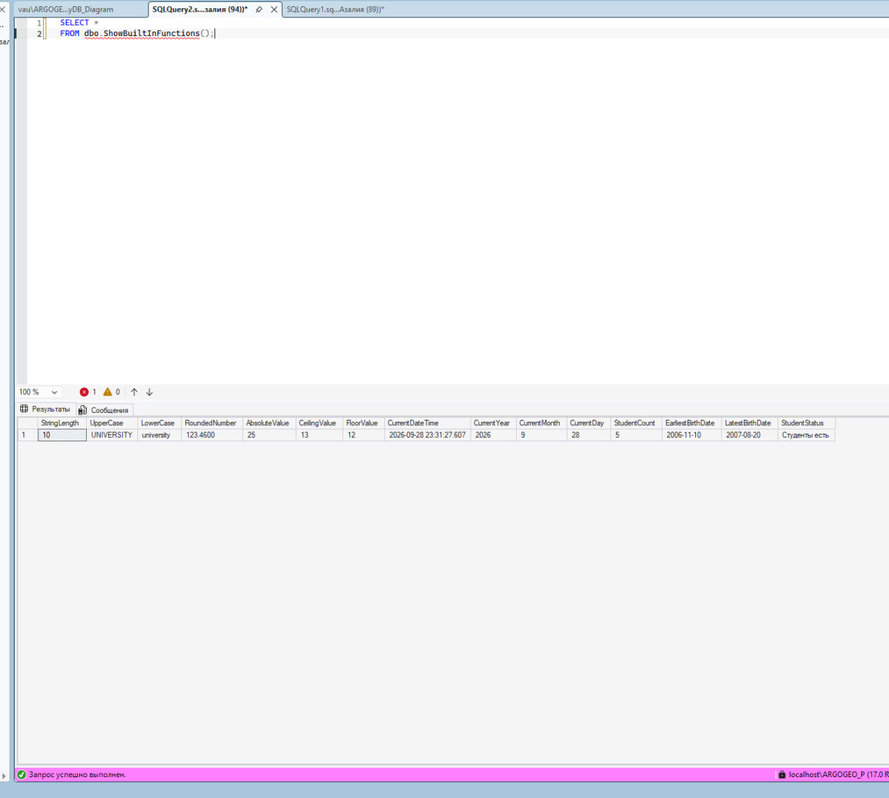
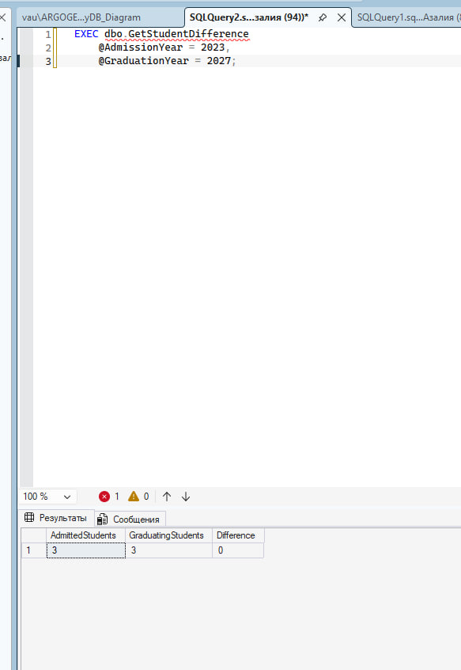

# Задание: #
## Вы должны создать процедуру и функцию

Функция показывает пример всех встроенных функций,
процедурар считает разницу между в выпусающимися студентами и поступившими

в дз отпраляете скрин где виден код и резуьтат, через репозиторий ##

Код:

Функция :

Процедура: 

